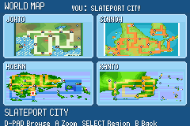

# Pokémon World v1.0

A GBA fan game by Srikar. Explore **Hoenn, Kanto, Johto and Sinnoh** in one adventure and one save.

## Download & play

[Visit the game website](https://fanzinewordsmith2.github.io/Pokemon_World/) or [download v1.0](docs/downloads/Pokemon-World-v1.0.gba).

Open the game in a GBA emulator such as mGBA or DotPlay. If updating, back up your save, keep the existing game filename, restart your emulator and choose **Continue** on the Pokémon title screen. Avoid quick states made with an older build.

## Features

- Four regions, with a Town Map available from the beginning.
- First visits safely store the old party in Someone’s PC.
- Up to two Pokémon from other regions can be retrieved into the party.
- A collection of regional Pokédex entries.
- Earned Mega reward recovery.
- Dynamax and Gigantamax, with compatible Pokémon selected through the Dynamax Band.

## About this repository

This repository distributes the website, screenshots and finished game download. The editable game source is private and is not included. Visitors cannot change this repository without the owner granting permission. Downloaded copies can be copied or modified independently.

Report problems through [Issues](https://github.com/fanzinewordsmith2/Pokemon_World/issues/new?template=bug_report.md).

## Credits

See [CREDITS.md](CREDITS.md). This is an unofficial fan project.

Game SHA-256: `7bc94abbac6696d80bf052a63ae6e65a27ebc040a143823e97edc7df994ff797`.
